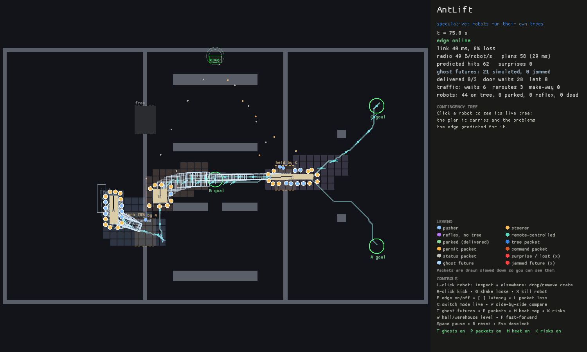

# AntLift

**Branch prediction for robot swarms.** A swarm of 16 robots carries a sofa along an S-shaped route through a factory hall: under a press line, up a narrow channel between machines, across the hall and into a loading dock. An edge server speculates on what might go wrong and ships each robot a tiny contingency tree, so robots react to predicted problems instantly and locally, and only call home when something surprises them.

Everything (physics, robots, edge server, radio) runs on one laptop.


*Side by side (`V`): the same scenario with the same clicks. Top: robots run their own contingency trees, with a trickle of radio packets. Bottom: the centralized baseline streams every command, so the radio is a constant cloud. Right: live comparison.*

**The warehouse** (`W`): three teams carry a sofa, a pallet and a 6 m beam through shared doors. The edge reserves each doorway for one payload at a time ("held by A"), shares the open floor between teams with block reservations and tiny permit messages (like an AGV traffic manager), and lends robots from delivered teams to the rest.



*Warehouse at 75 s: C holds the dispatch door, A the staging door, and B crosses the hall between them. The faint tiles are the floor each team has reserved, and the amber dots are permit packets.*

## Run it

```sh
cargo run --release                          # interactive demo
cargo run --release -- --warehouse           # start on the 3-team warehouse
cargo run --release -- --compare             # start in side-by-side mode
cargo run --release -- --select 3            # start with robot #3's tree open
cargo run --release --bin bench              # full benchmark (see Results)
cargo run --release --example trace -- --cond lossy --seed 2   # replay one benchmark run
cargo test --release
```

Screenshots for these docs are taken with `--shot <file.png> <seconds>`, which runs the demo in real time to that moment, saves the window and quits (for example `cargo run --release -- --warehouse --shot docs/warehouse.png 75`).

Debugging tools for the warehouse, all headless and deterministic:

```sh
cargo run --release --example traffic_debug -- 6 speculative 10   # waits, reroutes, positions every 10 s
cargo run --release --example contact_check -- 10 [notraffic]     # time teams spend touching, per run
cargo run --release --example team_debug -- 1 6 120               # one team's plan, doors and permits
cargo run --release --example push_check -- 9 2 95 110            # who is touching payload C
cargo run --release --example hall_check                          # the hall demo, headless
```

The toolchain is pinned in `rust-toolchain.toml` (rustup installs it automatically).

### What you're looking at


- **Radio packets** fly between the robots and the **EDGE** access point. Blue: contingency trees. Amber: traffic permits. Grey: acks and status. Orange: centralized commands. Teal: centralized state reports. Red: surprises. A red ✕ is a lost packet. Packets are drawn slowed down so you can see them.
- **Click a robot** to open its live contingency tree. The nominal plan runs down the left side, and the problems the edge predicted for that leg branch to the right (`stuck → back off → square up`). The robot's current step is filled in, and a branch flashes green when it fires.
- **Ghost futures:** faint sofa outlines are the 7 futures the edge simulated at its last plan (as planned, kicked, grip lost, robots down). A red ✕ marks a future that jammed. The edge sets its contingency probabilities from these.
- **Reserved floor** (warehouse): faint tiles tinted by team show the 1 m blocks each team owns or has been granted along its route. **WAITING for X** above a payload means it has reached the end of its grant and holds until X's floor frees up.
- **Choke points** (warehouse) are dashed boxes over the doorways: grey when free, amber with "held by X" when reserved, and "Y waits" when another team is queued. A **WAIT** marker shows where a queued team stops.
- **Risk badges** on the path (`jam 72%`) are the edge's predicted probabilities. **Red cells** are its learned map of places where predictions failed.
- **Overlays** (`T` ghost futures, `P` packets, `H` heat map, `K` risk badges) are listed under the controls as on or off. Some only have something to draw at times: ghost futures once a team grips its payload, the heat map after a surprise (drop a crate in the way to make one), and risk badges only on legs with at least a 30% predicted risk.
- **Panel:** time, link, radio per robot, plans, hits and surprises, and in the warehouse deliveries, door waits, robots lent, and traffic waits, reroutes and make-way moves.
- **Robots:** blue pushers, amber steerers, purple when running on reflexes (no valid tree), teal when remote-controlled by the baseline, and **green when parked**: the plan is finished and the payload is at its goal. A green ring flash means a predicted branch fired. A red one means a surprise was reported.
- **Delivered:** when every payload has arrived, a **DELIVERED** banner shows the time, robots settle and park, and after 3 s the run freezes so the radio goes quiet. Parked robots only check in every 5 s (about 1 B/robot/s, down from 40-60 while carrying), and the edge stops replanning and renewing their trees.

### Controls
| Input | Action |
|---|---|
| Left click | on a robot: inspect its tree · elsewhere: drop a crate (click a crate to remove it) |
| Right click | kick the payload |
| `G` / `X` | shake robots near the cursor loose / kill the nearest robot |
| `E` | take the edge server offline / online |
| `[` `]` / `L` | latency −/+ 50 ms / cycle packet loss 0, 10, 30 % |
| `C` | switch speculative ↔ centralized live (no restart) |
| `V` | side-by-side comparison (both start fresh; your actions apply to both) |
| `T` / `P` / `H` / `K` | toggle ghost futures / packets / learned heat map / risk badges |
| `W` | switch between the assembly hall and warehouse levels |
| `F` / `Space` / `R` / `Esc` | fast-forward ×4 / pause / reset / deselect |

## How it works

1. The edge plans the payload's route in SE(2) (position + heading) with the payload-plus-robots footprint.
2. For each leg it scores possible problems (jams, misalignment, grip loss) by probability × impact.
3. Each robot gets the nominal plan plus the highest-value contingencies that fit in **256 bytes**, pruned to its role.
4. Robots check the guards every tick using only local sensing. Predicted problems are handled with **zero round trips**.
5. A stall with no planned branch is a **surprise**. The edge raises its prior for that spot and replans.
6. Trees are leases. If the edge disappears, robots finish their cached plan, then fall back to ant-style reflexes.

## Algorithms

Every piece is written from scratch in Rust; the only external engine is Rapier for 2D rigid-body physics.

### Planning (edge)
- **SE(2) A\*** over position and heading: 0.25 m cells × 16 headings over 180° (the payload is symmetric end to end). Moves are one-cell translations or in-place turns, so the search is holonomic like the swarm.
- **Footprint:** payload plus the robots gripping it, approximated by a chain of circles along its long axis and checked against an **exact clearance map** (distance from every cell to the nearest obstacle).
- **Swept turns:** an in-place turn also checks the halfway angle, so a long payload can't "teleport" round in a gap narrower than itself.
- **Heuristic:** a 2D Dijkstra distance-to-goal field. It is admissible, and it also prunes cells that can't reach the goal.
- **Cost shaping:** tight cells cost more (routes stay centred in gaps), places where surprises happened cost more (a learned heat map), spots where a simulated future jammed cost more, and cells off the current route cost more unless that route went wrong (so routes don't flip as the world moves).
- **Escape:** a payload already wedged against a wall may take any step that increases its clearance.
- **Optional smoothing:** shortcut smoothing that turns while moving. Off by default, because an A/B test showed it hurts this controller (see the design doc).

### Speculation (edge)
- **Contingency candidates** per waypoint: jam (back off, square up, retry), misalignment (pushers pause while steerers turn), grip loss (re-grip). Each gets a probability from heuristics (tightness, turn angle, observed grip losses, learned heat).
- **Ghost futures:** the edge rebuilds the physics world from its camera snapshot and simulates 7 futures in parallel (as planned, kicks, grip loss, robots dying) with the exact trees robots would get. Where futures jam updates the probabilities as a Beta-style blend with the prior.
- **Tree building:** the nominal chain plus contingencies chosen greedily by probability × impact, under a **256-byte budget**, pruned per role (steerers don't get "pause while turning").

### Execution (robots)
- **Contingency tree** = a guarded state machine. Each tick a robot checks its node's edges against local sensing only and follows the first that holds. Predicted problems are handled with no network round trip.
- **Control:** robots drive with a local velocity loop. When gripping, every robot runs the same feed-forward + P law on the payload's velocity; steerers (far from the centre) add a tangential term to control heading. Pushers and steerers agree without talking because they compute from the same estimate.
- **Stall detection** by lack of net progress over a window (robust to jiggling), **re-localization** in the plan after re-gripping, and **ant-style reflexes** when no valid tree is held.
- **Traffic permits:** a robot won't start a leg beyond its permit. It holds the payload where it is, and waiting doesn't count as a stall.
- **Final hold and parking:** at the end of its plan near the goal, a robot holds the payload *on* the goal, not just still. Once the payload has settled there it parks: it checks in only every 5 s and no longer needs a lease. It goes back to work if the payload is pushed more than 2.5 m off its goal or a new plan arrives. Robots that aren't gripping a delivered payload stay out of its way.

### Protocol (radio)
- Compact binary trees (positions in cm, angles in 0.1 mrad), 7-byte **traffic permits**, tree and **lease** acknowledgements, **byte-identical retransmission** with an RTT estimate (EWMA, Karn's rule) and exponential backoff, and leases so robots keep working through edge outages.
- The radio is simulated in sim time: latency, jitter, loss and outages, with every byte counted.

### Coordination (several teams)
- Each team plans separately; only delivered payloads are obstacles for the others.
- **Choke-point reservations** are granted just in time (within 10 m) and in chains that can't be stopped inside, so teams queue in front of busy doorways and never deadlock.
- **Traffic control by block reservation** (as in industrial AGV fleets): the floor is cut into 1 m blocks. Each team owns the blocks under it and is granted the blocks along the next 5 m of its route, in priority order (in a doorway first, then least route left), and grants are never taken back. A team that can't get its next stretch books it, so nobody slips in front.
- **Permits instead of replans:** how far a team may go is a 7-byte message ("up to node N"). Robots hold at the end of their grant without counting it as a stall, and the plan and its contingencies stay untouched.
- **Deadlock detection:** waits form a wait-for graph. In a cycle (two teams head-on) the lowest-priority team reroutes off the others' floor, and teams take turns if that doesn't work. If there's no way round at all, the team moves to a nearby **make-way spot** and resumes from there.
- **Delivered means settled:** a payload counts as delivered only once it has stopped on its goal. Delivered payloads keep their floor and become obstacles (a chain of small boxes that fits a payload at an angle), and every other team replans round them.
- **Robot lending:** robots of delivered teams move to the team with the fewest robots per square metre of payload, but only into a grip spot that is actually free.
- **Transit routes:** a robot that has to reach a payload it can't drive straight to (walls, racks or a parked payload in the way) gets up to 8 waypoints round them in its tree, planned on the edge with a 2D distance field and line-of-sight shortcuts. It follows them, then makes its normal final approach.

### Baseline
- **Centralized control** runs the *same* brain code on the edge for every robot and streams commands at 20 Hz (velocity setpoints while approaching, so robots keep a fast local loop). The only difference between the modes is where decisions run.

## Results

Against a **centralized baseline that runs the identical decision code on the edge** and streams commands at 20 Hz (10 seeds per cell, 95% CIs):


- **7-10× less radio traffic** (45-68 vs about 440 B/robot/s), with every variant delivering in every run on the hall. On a perfect link centralized is a few seconds faster.
- **Flat under latency:** speculative delivers in 76-87 s from 0 to 1000 ms of one-way latency. Centralized slows from 200 ms, succeeds in only 4 of 10 runs at 500 ms and 2 of 10 at 750 ms, and fails every run at 1 s.
- **Survives edge outages** of up to 40 s in every run, with robots working through cached leases.
- **Warehouse** (3 payloads, 44 robots): every variant delivers all 3 payloads in every run (150/150), in 127-176 s, with 5-8× less radio for speculative. Centralized is slowest on a slow link (169 s).
- **Traffic control** stops teams bumping into each other: time spent in contact fell from 28.2 to 0.1 s per run (speculative) and from 33.2 to 0.0 s (centralized), with no extra replanning. It costs 14-27 s per run, because teams now wait for floor instead of shoving through.
- **Ghost futures** (probabilities from simulated futures rather than hand-written priors) don't reliably help: within noise on the hall, and in the warehouse faster in three conditions and slower in two. Details are in the design doc.

Building a fair baseline also exposed six real bugs, including a retransmit storm and a shared re-localization bug that had inflated early results. The methodology, every number, and that list are in [docs/design.md](docs/design.md#4-evaluation).

```sh
cargo run --release --bin bench     # 720 runs, ~4 min on 20 cores → results/
uv run scripts/plot.py              # → docs/img/
```

## Layout

```
crates/core   protocol (trees, wire format, messages) and the shared robot brain
crates/net    simulated radio: latency, jitter, loss, outages, byte accounting
crates/sim    Rapier 2D world; runs the brains on-robot, or applies remote commands
crates/edge   SE(2) A* planner, contingency speculation, per-robot tree builder, traffic manager
app           one-laptop runtime (inline or threaded edge), scenarios, benchmark
app/src/ui    demo drawing: world + radio packets, live tree diagram, comparison panel
app/examples  headless debugging tools (traces, contact and push checks, A/B tests)
scripts       plotting (uv run scripts/plot.py)
results       benchmark output (CSV + summary)
```

## License

MIT OR Apache-2.0
