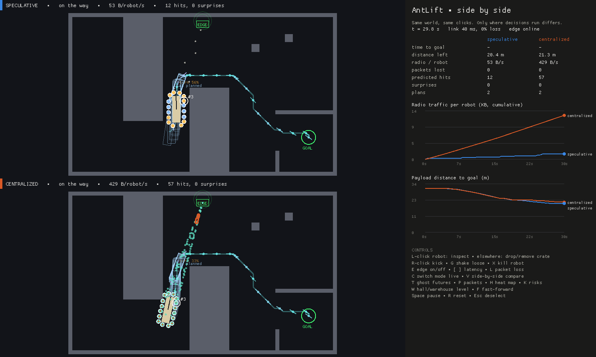
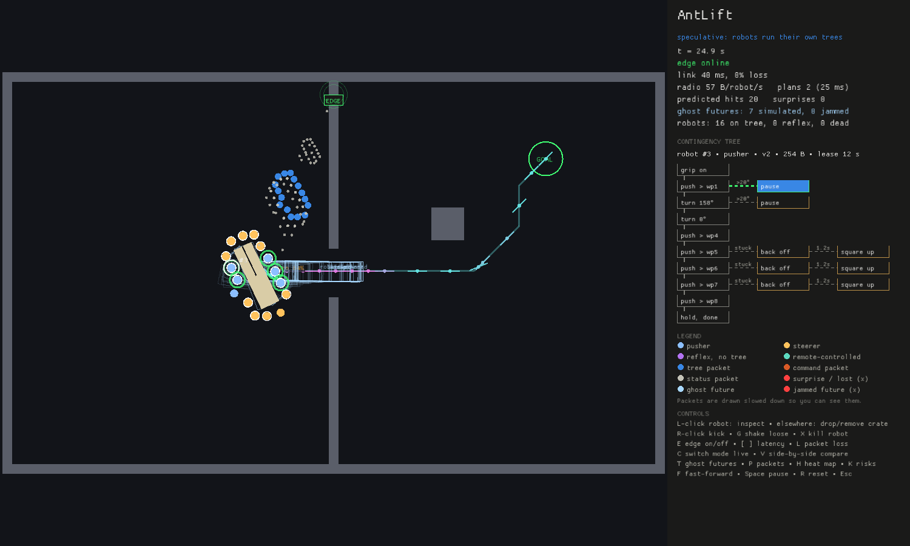
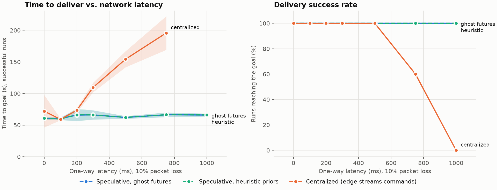

# AntLift

**Branch prediction for robot swarms.** A swarm of 16 robots carries a sofa through a doorway. An edge server speculates on what might go wrong and ships each robot a tiny contingency tree, so robots react to predicted problems instantly and locally, and only call home when something surprises them.

Everything (physics, robots, edge server, radio) runs on one laptop.



*Side by side (`V`): the same scenario with the same clicks. Top: robots run their own contingency trees, with a trickle of radio packets. Bottom: the centralized baseline streams every command, so the radio is a constant cloud. Right: live comparison.*

## Run it

```sh
cargo run --release                          # interactive demo
cargo run --release -- --compare             # start in side-by-side mode
cargo run --release -- --select 3            # start with robot #3's tree open
cargo run --release --bin bench              # full benchmark (see Results)
cargo run --release --example trace -- --cond lossy --seed 2   # replay one benchmark run
cargo test --release
```

The toolchain is pinned in `rust-toolchain.toml` (rustup installs it automatically).

### What you're looking at



- **Radio packets** fly between the robots and the **EDGE** access point. Blue: contingency trees. Grey: acks and status. Orange: centralized commands. Teal: centralized state reports. Red: surprises. A red ✕ is a lost packet. Packets are drawn slowed down so you can see them.
- **Click a robot** to open its live contingency tree. The nominal plan runs down the left side, and the problems the edge predicted for that leg branch to the right (`stuck → back off → square up`). The robot's current step is filled in, and a branch flashes green when it fires.
- **Ghost futures:** faint sofa outlines are the 7 futures the edge simulated at its last plan (as planned, kicked, grip lost, robots down). A red ✕ marks a future that jammed. The edge sets its contingency probabilities from these.
- **Risk badges** on the path (`jam 72%`) are the edge's predicted probabilities. **Red cells** are its learned map of places where predictions failed.
- **Robots:** blue pushers, amber steerers, purple when running on reflexes (no valid tree), teal when remote-controlled by the baseline. A green ring flash means a predicted branch fired. A red one means a surprise was reported.

### Controls
| Input | Action |
|---|---|
| Left click | on a robot: inspect its tree · elsewhere: drop a crate (click a crate to remove it) |
| Right click | kick the payload |
| `G` / `X` | shake robots near the cursor loose / kill the nearest robot |
| `E` | take the edge server offline / online |
| `[` `]` / `L` | latency −/+ 50 ms / cycle packet loss 0, 10, 30 % |
| `C` | switch speculative ↔ centralized live (no restart) |
| `V` | side-by-side comparison (both start fresh; your actions apply to both) |
| `T` / `P` / `H` / `K` | toggle ghost futures / packets / learned heat map / risk badges |
| `F` / `Space` / `R` / `Esc` | fast-forward ×4 / pause / reset / deselect |

## How it works

1. The edge plans the payload's route in SE(2) (position + heading) with the payload-plus-robots footprint.
2. For each leg it scores possible problems (jams, misalignment, grip loss) by probability × impact.
3. Each robot gets the nominal plan plus the highest-value contingencies that fit in **256 bytes**, pruned to its role.
4. Robots check the guards every tick using only local sensing. Predicted problems are handled with **zero round trips**.
5. A stall with no planned branch is a **surprise**. The edge raises its prior for that spot and replans.
6. Trees are leases. If the edge disappears, robots finish their cached plan, then fall back to ant-style reflexes.

## Results

Against a **centralized baseline that runs the identical decision code on the edge** and streams commands at 20 Hz (10 seeds per cell, 95% CIs):



- **6-9× less radio traffic** (50-70 vs about 440 B/robot/s) for the same time to goal on clean, slow and lossy links.
- **Flat under latency:** speculative delivers in 60-66 s from 0 to 1000 ms of one-way latency. Centralized slows from 200 ms and fails every run at 1 s.
- **Survives edge outages** of up to 40 s in every run, with robots working through cached leases.
- **Honest loss:** centralized is slightly faster when the payload is repeatedly kicked (72.8 vs 76.6 s).
- **Ghost futures** (probabilities from simulated futures rather than hand-written priors) didn't measurably change outcomes on this level. The heuristics were already good enough, and the dashed line overlaps. Details are in the design doc.

Building a fair baseline also exposed six real bugs, including a retransmit storm and a shared re-localization bug that had inflated early results. The methodology, every number, and that list are in [docs/design.md](docs/design.md#4-evaluation).

```sh
cargo run --release --bin bench     # 570 runs → results/
uv run scripts/plot.py              # → docs/img/
```

## Layout

```
crates/core   protocol (trees, wire format, messages) and the shared robot brain
crates/net    simulated radio: latency, jitter, loss, outages, byte accounting
crates/sim    Rapier 2D world; runs the brains on-robot, or applies remote commands
crates/edge   SE(2) A* planner, contingency speculation, per-robot tree builder
app           one-laptop runtime (inline or threaded edge), scenarios, benchmark
app/src/ui    demo drawing: world + radio packets, live tree diagram, comparison panel
scripts       plotting (uv run scripts/plot.py)
results       benchmark output (CSV + summary)
```

## License

MIT OR Apache-2.0
