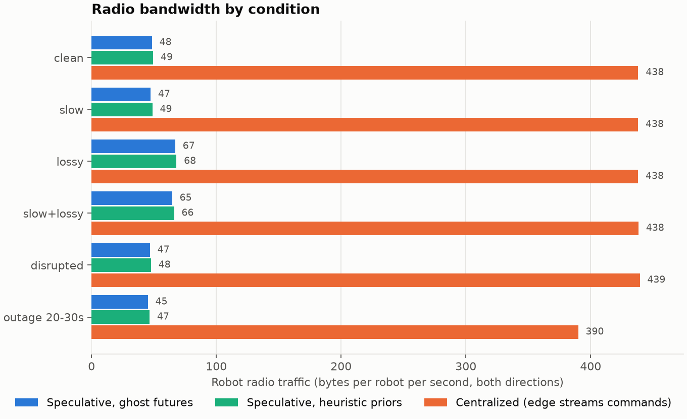
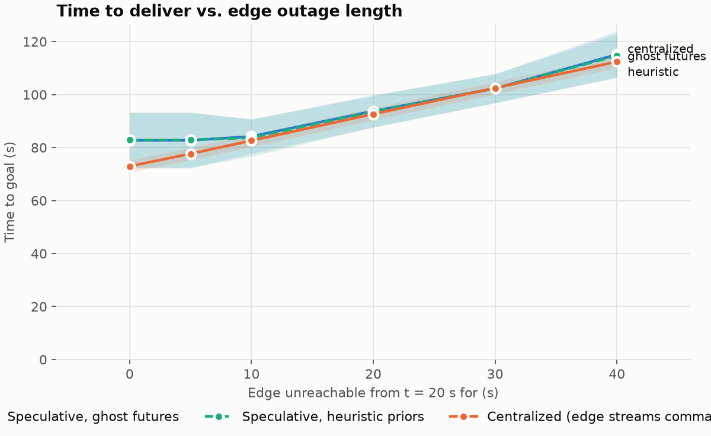
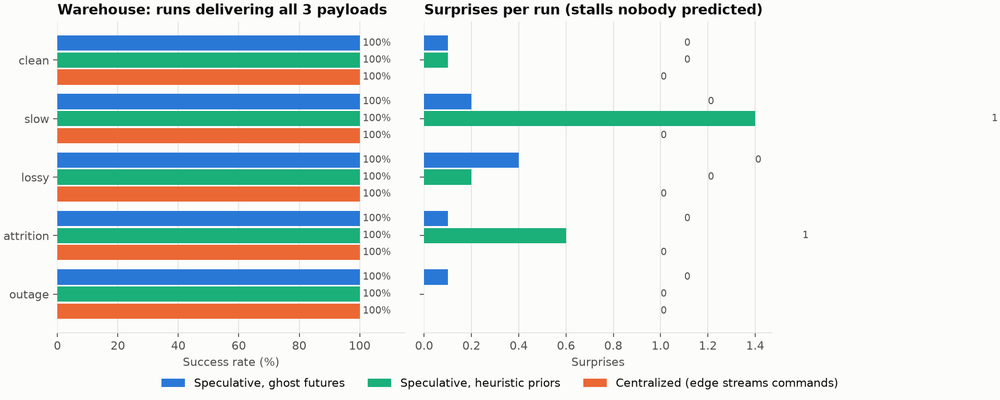

# AntLift design

Status: v0.4. The swarm, the edge server and the network all run on one laptop, and the method is evaluated against a centralized baseline.

## 1. Problem

A swarm of small robots has to carry a large, awkward payload (a 4 m sofa) through a cluttered building. The usual architectures each fail in their own way:

| Architecture | Strength | Failure mode |
|---|---|---|
| Central server sends commands every tick | Global view, good decisions | Every reaction waits a network round trip, and the swarm freezes if the server dies |
| Fully decentralized (ant rules) | Instant reactions, no single point of failure | Only local view, so it jams in doorways the global map says need a turn first |

## 2. Core idea: branch prediction for swarms

CPUs don't stall on an `if`: they predict the branch and have both outcomes ready. AntLift applies the same idea to robot coordination.

1. The **edge server** keeps a global model and **speculates** on what could go wrong on each leg of the route (jam in a doorway, heading drifting, a robot losing its grip).
2. It compiles the nominal plan plus the most valuable contingencies into a **contingency tree**: a small guarded state machine.
3. Each robot gets **its own slice**, pruned to what its role can act on and capped at a **byte budget**.
4. Robots evaluate the guards **locally, every tick**. When a predicted contingency happens, the robot switches branch immediately with no network round trip. That's a **prediction hit**.
5. When something happens that the tree has no branch for, the robot reports a **surprise**. The edge raises its prior for that place and situation (it learns where its predictions fail) and replans.
6. Trees are **leases**. If the edge goes quiet, robots keep running their cached tree until it expires, then fall back to reflexes.

```
                 ┌──────────────────────── EDGE SERVER (own thread) ─────────────────────────┐
 camera 2 Hz ──▶ │ SE(2) planner ─▶ waypoints ─▶ candidates ─▶ ghost futures ─▶ per-robot trees │
                 │      ▲                         (scored p × impact,     (role-pruned,       │
                 │      └── surprise heat map ◀── surprises               ≤ 256 B each)       │
                 └───────────────▲─────────────────────────────────────────────┬─────────────┘
                     heartbeats, │ branch-fired, surprises        trees (only on │ change / lease renewal)
                       (≤ 12 B)  │                                              ▼
                 ┌───────────────┴──────────── SIMULATED RADIO ───────────────────────────────┐
                 │   latency, jitter, loss, outage, byte accounting  (sim-time driven)         │
                 └───────────────▲─────────────────────────────────────────────┬─────────────┘
                                 │                                              ▼
                 ┌───────────────┴──────────────── SWARM (Rapier 2D) ─────────────────────────┐
                 │  robot brains: follow tree edges on local sensing → control law → force    │
                 │  no valid tree → reflex rules                                               │
                 └────────────────────────────────────────────────────────────────────────────┘
```

## 3. Components

### 3.1 `antlift-core`: protocol
- `ContingencyTree`: nodes hold an `Action` (`Approach`, `Push{target, heading}`, `Rotate{heading}`, `Hold`) and ordered guarded `Edge`s. Each edge has a `Predicate` (`InContact`, `ContactLost`, `Reached`, `HeadingOff`, `HeadingOk`, `Stalled`, `After`) and a `speculative` flag.
- **Wire format**: hand-rolled binary. Positions are quantized to cm (i16), angles to 0.1 mrad (i16) and durations to 10 ms (u16). Typical trees are 100-250 B. Decoding rejects truncated input and dangling node references.
- Messages: `Uplink` (`Heartbeat`, `BranchFired`, `Surprise`, `TreeAck`, `Camera`, and the baseline's `State`) and `Downlink` (a tree, a 7-byte traffic `Permit`, or the baseline's `Command`), each with a `wire_len()`.
- `Brain` (decision logic) lives here too, so robots and the centralized baseline run identical code.

### 3.2 `antlift-net`: simulated radio
One-way `Link<T>` driven by **sim time**, so results don't depend on how fast the laptop is. It models latency, jitter, Bernoulli loss and outages (an outage also drops packets already in flight), and counts bytes even for lost packets, since the airtime was still spent.

### 3.3 `antlift-sim`: swarm and physics
- Rapier 2D, top-down, no gravity. Floor friction is modelled as damping. The payload is a 4 × 1.2 m box. Robots are 0.25 m discs with a 25 N force limit that grip the payload through revolute joints.
- **Brain** (one per robot, sees only its own `Sense`):
  - follows tree edges, reports `BranchFired` (speculative ones count as hits);
  - **stall detection**: "stalled" means no net progress (under 15 cm and 3°) since a progress anchor was set. If the current node has no `Stalled` edge, the robot reports a `Surprise` every 3 s until it gets help;
  - **re-localization**: after (re)gripping, it jumps to the plan leg the payload is actually closest to;
  - **escalation**: if a planned jam recovery fires 3 times without any nominal progress, the prediction was right but the fix isn't working, so that also becomes a surprise;
  - approach controller that matches the slot's velocity and orbits around the payload when it's in the way;
  - **carry law**: every gripping robot runs the same law on the same estimate, so the swarm agrees without talking. Translation uses a feed-forward + P term toward the waypoint, scaled down while the heading error is large (turn first, then move). Steerers (grip points far from the centre) add a tangential term for heading control.
  - **reflex mode** (no valid tree): grab the nearest free point and push straight at the goal beacon.
  - **traffic permits**: a tree carries a permit ("you may advance up to node N"), and permit messages raise it later. A robot whose next leg isn't permitted holds the payload where it is. Waiting for traffic doesn't count as a stall, so it raises no jam branches or surprises;
  - **final hold**: at the end of a plan near the goal, robots hold the payload *on the goal* (a gentle push toward it at the heading it arrived with) rather than just still. A velocity-only hold let payloads coast or creep a metre off with nobody to bring them back;
  - **parked mode**: at the end of its plan, gripping a payload that's within 1 m of its goal and has settled (under 0.1 m/s), a robot parks. It holds, sends a heartbeat every 5 s instead of every second, and no longer depends on its lease. The edge stops replanning delivered teams and stops renewing parked robots' leases. In the centralized baseline the edge stops commanding parked robots, and robots that hear nothing for 1 s slow their state reports to 1 Hz. After delivery the radio drops to about 1 B/robot/s (speculative) and 16 B/robot/s (centralized).

### 3.4 `antlift-edge`: the edge server
- **Planner**: holonomic SE(2) A* over (0.25 m cell, 16 headings over π). Clearance is computed exactly from obstacle geometry. The footprint (payload plus gripping robots) is a chain of circles. A 2D geometric distance-to-goal field is the admissible heuristic and also prunes cells that can't reach the goal. Moves that increase clearance are allowed even from a colliding pose, so a payload shoved against a wall can still be planned out. Cells with little slack cost extra, which keeps plans centred in gaps. Typical plan: about 30 ms.
- Movable crates block the first planning attempt. If no route exists, it plans through them and relies on jam contingencies.
- **Waypoints**: every 2 m in the open, every 1 m in tight spots, and wherever the heading changes by more than 20°. In-place turns become `Rotate` nodes.
- **Speculation**: for each waypoint within the horizon (8) it scores candidates by `p × impact`:
  - Jam: `p = 0.05 + 0.8·tightness + heat(location)`, recovery = back off → square up → retry
  - Misalign (pushers only): `p ∝ heading change`, recovery = pause until aligned
  - Grip loss: `p = 0.03 + 0.05·observed_grip_losses`, recovery = re-approach and re-grip
  Candidates are added greedily while the encoded tree fits the byte budget.
- **Ghost futures** (`rollout.rs`): after each plan, the edge rebuilds the physics world from its camera snapshot and runs 7 futures in parallel for 10 s. Each future uses the exact trees the robots would receive: as planned, kicks of 80 and 150 N·s from either side, front robots losing grip, and 3 robots dying. A future "jams" if the payload makes no net progress for 2 s. Jam and misalignment probabilities per waypoint are then updated as a Beta-style blend, `p = (prior·2 + futures that jammed there) / (2 + futures)`. The futures are kept with the plan and drawn in the demo.
- **Roles and slots**: robots are spread evenly around the perimeter, and robots already gripping keep their spot. Robots far from the centre become steerers. Steerer trees don't get misalignment branches, because steerers are the ones fixing it.
- **Reliable delivery**: robots acknowledge each tree and lease. The edge retransmits byte-identical copies after an RTT-adaptive timeout with exponential backoff.
- **Event-driven replanning**: it replans on a surprise, a change in obstacles, the payload drifting more than 2.5 m off the path, or the payload nearing the end of the horizon (seen by the camera, so it still works if the robots' reports are lost). Otherwise it only renews leases (every 8 s, lease 12 s).

### 3.5 Multiple teams (the warehouse)
A level is a list of payloads, each with a goal and a team of robots, plus authored **choke points** (doorways only one payload may use at a time). On top of the single-team machinery, the edge:
- **plans each team separately.** Payloads still on the move are not obstacles to each other's plans (sharing the floor is the traffic manager's job, below; treating them as walls made routes flip as they came and went). Delivered payloads are, as a chain of small boxes along their axis, which fits a payload parked at an angle far better than one box round it. When a payload is delivered, every other team replans round it at once.
- **reserves choke points.** A team claims the next choke point on its route once it is within 20 m of it, together with any choke points chained too closely behind it to stop between, so nobody ever waits *inside* a corridor. If another team holds any of them, the plan stops a body length in front and the team queues. A reservation is released when the owner's payload has passed through, and queued teams replan straight away.
- **shares the open floor with block reservations** (`traffic.rs`), the way industrial AGV traffic managers do it. The floor is cut into 1 m blocks. Each team owns the blocks under its payload and robots, and asks for the blocks its footprint sweeps along the next 5 m of its route, one leg (waypoint) at a time. Grants go out in priority order (a team inside a doorway first, then the one with the least route left) and are never taken back, so a team only ever drives onto floor reserved for it. A team that can't get its next leg *books* that leg's free blocks, so lower-priority teams can't slip in front of it. Delivered payloads and teams queued at a door keep their floor too.
  - **Permits, not replans.** How far a team may go is sent as a 7-byte permit ("up to node N") to each of its robots, and robots hold at the end of their grant. The plan and its contingencies stay as they are, so waiting costs no replanning. A permit goes out when it changes, and is resent if a robot still sits at the old limit 1.5 s later (it was probably lost). That adds about 1.5 B/robot/s. Centralized control applies the same permits to the edge-hosted brains. On single-team levels there's nothing to share, so permits stay unlimited.
  - **Deadlocks.** Who waits for whom forms a wait-for graph. A cycle is a deadlock (typically two teams head-on), and the lowest-priority team in it reroutes: it replans keeping off the others' bodies and the floor they are about to drive, but not off the floor it stands on, or it couldn't start. If that team rerouted in the last 10 s, the next lowest goes instead, so the teams take turns rather than retrying a move that didn't work. A team stuck behind the same team for 15 s without a cycle reroutes too.
- **routes robots in transit.** Robots only drive straight at their grip spot, so a robot lent to a team across the warehouse used to walk into walls. When the straight line is blocked, the edge plans the robot a route on a 2D distance field (walls plus parked payloads with a 0.3 m berth), shortens it by line of sight, and sends up to 8 waypoints in the tree. A robot starting pressed against the payload it just left first steps out to the *nearest* free cell (not the one nearest its goal, which can be across a thin beam). Every lent robot now reaches its new payload, unless that payload is delivered first.
- **lends robots.** When a payload is delivered, its robots move to the undelivered teams with the fewest robots per square metre of payload, but only up to what fits around that payload. Their next tree carries the new team id, and the robot lets go and walks over.
- **plans around trouble.** The learned surprise map is a route-cost penalty, not just a contingency prior. When a team's own "as planned" ghost future jams, that spot becomes costly for the team and it replans immediately, before anything is sent.
- In-place turns check the space swept *between* planner headings, so a long payload can't plan to rotate through a gap narrower than its length.

### 3.6 `antlift` app: one-laptop runtime
- `Session` wires swarm ↔ links ↔ edge at a fixed 60 Hz sim tick.
- `EdgeRuntime::Inline` runs the edge in the same thread, deterministically (bench, tests). `EdgeRuntime::Thread` puts the edge on its own thread, talking only over channels, so planning time is real and the UI never blocks.
- Interactive UI (macroquad): drop crates, kick payloads, shake robots loose, kill robots, take the edge offline, change latency and loss, switch between speculative and centralized control (`C`), compare both side by side (`V`), and switch between the assembly hall and warehouse levels (`W`). Radio packets, contingency trees, risks, ghost futures, choke-point reservations and the floor each team has reserved are all drawn live.

## 4. Evaluation

### 4.1 Method

**Levels.** The single-team level is an **assembly hall**: a 4 m sofa weaves an S-shaped route under a press line, north up a 4 m channel between two machines (upright), across an aisle with parts racks, south down the dock corridor and into a loading-dock bay through a 5.5 m mouth. It replaced an earlier level (two rooms joined by a narrow doorway) that was too close to the classic ant load-carrying experiment. The multi-team level is the warehouse (section 4.6). Ghost futures are only simulated once at least half a team grips its payload: before that every future "jams" because nothing moves.

- **Two control modes, same brain.** In *speculative* mode each robot runs its brain on its own sensing and an edge-issued tree. In *centralized* mode the edge runs **the identical brain code** for every robot, using streamed robot state (20 Hz) and a 20 Hz camera feed (dead-reckoned forward to cover camera latency), and streams commands back at 20 Hz. To give the baseline a fair shot:
  - while a robot is approaching the payload, the edge sends **velocity setpoints** and the robot closes its velocity loop locally at 60 Hz;
  - robots report their exact grip point;
  - commands are held until the next one arrives, and a 0.3 s watchdog stops a robot if commands stop coming.
  So the only difference between the modes is *where decisions are made*.
- **Conditions:** clean (40 ms), slow (150 ± 50 ms), lossy (20% loss), slow+lossy, disrupted (two kicks, a crate dropped in the upper aisle, front robots shaken loose), and a 10 s edge outage.
- **Sweeps:** one-way latency from 0 to 1000 ms (10% loss), and edge outage length from 0 to 40 s.
- **Seeds:** 10 per cell. Each seed randomizes the payload's start pose (±1 m, ±0.4 rad) and the radio's random generator. 720 runs take about 4 minutes on 20 cores (ghost futures with 44 robots dominate).
- **Metrics:** success within 240 s, time to goal (mean ± 95% CI over successes), and robot radio bytes per robot per second in both directions (the camera feed is infrastructure and isn't counted).

Reproduce with `cargo run --release --bin bench && uv run scripts/plot.py`.

### 4.2 Results

Three variants: **speculative** (ghost futures), **speculative-heuristic** (the same, with ghost futures off), and **centralized**. Cells are success · time to goal (s) · radio (B/robot/s).

| Condition | Speculative | Speculative, heuristic | Centralized |
|---|---|---|---|
| clean | 10/10 · 82.8 ± 10.4 · 47 | 10/10 · 83.0 ± 10.4 · 48 | 10/10 · 72.9 ± 2.3 · 438 |
| slow (150 ms) | 10/10 · 78.3 ± 3.0 · 47 | 10/10 · 78.5 ± 2.9 · 48 | 10/10 · 75.5 ± 4.4 · 438 |
| lossy (20%) | 10/10 · 75.1 ± 2.1 · 67 | 10/10 · 75.2 ± 2.0 · 68 | 10/10 · 73.8 ± 3.2 · 438 |
| slow + lossy | 10/10 · 81.0 ± 4.3 · 64 | 10/10 · 81.5 ± 4.2 · 66 | 10/10 · 77.0 ± 2.4 · 438 |
| disrupted | 10/10 · 85.9 ± 7.4 · 46 | 10/10 · 87.3 ± 8.5 · 47 | 10/10 · 77.0 ± 0.9 · 439 |
| 10 s edge outage | 10/10 · 84.1 ± 6.5 · 45 | 10/10 · 83.6 ± 7.1 · 46 | 10/10 · 82.6 ± 2.3 · 390 |

Full tables, including both sweeps for all three variants, are in `results/summary.md`.





### 4.3 What the data supports
1. **7-10× less radio traffic for the same task.** Speculative uses 45-68 B/robot/s against 390-440 for centralized. Every variant succeeds 10/10 in every condition. On a good link centralized is a few seconds faster (for example 72.9 vs 82.8 s clean), because it reacts to everything at 20 Hz with the full picture.
2. **Latency tolerance is the decisive difference.** Speculative time to goal stays within 76-87 s from 0 to 1000 ms of one-way latency (10/10 at every point). Centralized slows from 200 ms (84 s), takes 139 s at 300 ms, and succeeds in only 6/10 runs at 500 ms, 2/10 at 750 ms and 0/10 at 1000 ms. The hall's three turns make remote control break down sooner than the old single doorway did.
3. **Outages:** every variant recovers in every run, up to 40 s offline. Times are within about 5 s of each other, with centralized slightly ahead.
4. **Ghost futures don't reliably help.** On the hall they are within noise of heuristic priors. In the warehouse (section 4.6) they are faster in three conditions and slower in two. Simulating futures also costs compute: about 25 ms per plan per team, and most of the benchmark's CPU.
5. **Centralized is also faster when disrupted** (77.0 vs 85.9 s) and has lower variance on a clean link. With 20 Hz state it reacts to kicks with full information, while speculative robots only react to the contingencies they were given.

### 4.4 What the data does *not* support (yet)
- Two levels: the assembly hall with one payload, and the warehouse with three. Larger swarms and other layouts are untested.
- Ghost futures are 7 hand-chosen disruptions, simulated with perfect knowledge of the snapshot. Real perception noise and model mismatch between the edge's simulator and the world aren't modelled, because the "real" world here is the same simulator.
- The radio model is Bernoulli loss with uniform jitter: no bursty loss, no bandwidth cap, no contention.
- The 1 s latency case is extreme for a local edge. It stands in for cellular or long-haul links rather than Wi-Fi.

### 4.5 Bugs the baseline exposed
Building a fair baseline and sweeping conditions found real defects. Several of them were hurting the method itself:

| Symptom | Root cause | Fix |
|---|---|---|
| Speculative 6/10 on lossy links | Trees sent once, with no acknowledgement | Tree acks + retransmission |
| Still failing after acks | Acks covered the plan version, not lease renewals, so leases silently expired | Acknowledge the lease (`valid_until`) |
| 650 B/robot/s at 200 ms latency | Retransmissions were rebuilt with a fresh lease, so acks never matched (a retransmit storm) | Byte-identical retransmits, RTT-adaptive timeout (Karn's rule), exponential backoff |
| Centralized 3× slower on some seeds | Late-gripping robots started at waypoint 1 and dragged the payload backwards (a bug in the *shared* brain) | Re-localize in the plan after gripping |
| Wedged payload after long outages, 200 replans | Planner refused colliding start poses; failed plans re-triggered every camera frame | Planner may move out of collision; failed plans retry on a 2 s timer |
| Payload jammed at the door forever | Stall detection used instantaneous speed, and a jiggling payload never counted as stalled | Stall = no net progress (15 cm or 3°) over a window |

The warehouse exposed more:

| Symptom | Root cause | Fix |
|---|---|---|
| Pallet never moved | Level bug: the 3.5 m staging doors were too narrow for the pallet's circle-chain footprint (3.44 m needed) | 4 m staging doors |
| 27 robots stuck on reflexes | Lent robots exceeded the space around their new payload, so they never got a grip slot (and so never a tree) | Capacity-limited lending; gap-filling slot search |
| Beam jammed for 200 s, all 7 ghost futures jamming | Planner let a 7 m payload rotate in place through a 3.7 m gap (it only checked discrete headings), and surprise-triggered replans reset every recovery | Swept-turn checks; replan around a jam the "as planned" future shows; surprises replan at most every 2 s |
| Teams queuing for doors they didn't use | Choke-point zones extended 3 m either side of the wall, so passing routes clipped them | Zones cover just the doorway (±1.5 m) |

The last fix also removed an apparent ghost-futures advantage (48 vs 44 of 50) that came from the over-wide zones causing extra jams, not from the method.

Early results (before these fixes) suggested a large speed advantage for speculative control. That turned out to be mostly the shared re-localization bug, which hurt the remote loop more. The numbers above are after all fixes, for both modes.

### 4.6 Warehouse: three teams, shared doors

Same three variants, 10 seeds per condition (start poses jittered ±0.5 m, ±0.2 rad), 420 s limit. Success means all three payloads were delivered, and time is when the last one arrived.

| Condition | Speculative | Speculative, heuristic | Centralized |
|---|---|---|---|
| clean | 10/10 · 138.3 ± 12.3 · 46 | 10/10 · 161.2 ± 20.8 · 44 | 10/10 · 138.7 ± 8.0 · 354 |
| slow (150 ms) | 10/10 · 137.3 ± 15.4 · 45 | 10/10 · 152.6 ± 18.4 · 46 | 10/10 · 168.5 ± 19.0 · 333 |
| lossy (20%) | 10/10 · 139.2 ± 12.8 · 64 | 10/10 · 173.6 ± 16.7 · 61 | 10/10 · 127.3 ± 4.3 · 354 |
| attrition (1 in 4 robots die at 40 s) | 10/10 · 153.9 ± 17.2 · 41 | 10/10 · 146.4 ± 13.0 · 41 | 10/10 · 150.9 ± 8.8 · 312 |
| 15 s edge outage at 40 s | 10/10 · 150.2 ± 12.5 · 43 | 10/10 · 130.5 ± 5.3 · 46 | 10/10 · 152.5 ± 9.0 · 320 |



What it shows:
1. **Coordination works in every variant.** Teams queue for doors, share the open floor through block reservations (section 4.9), break deadlocks, and lend robots only where a grip spot is free. Teams now spend 0-0.1 s per run in contact, against 28-33 s without traffic control.
2. **Every variant delivers in every run (150/150).**
3. **No variant is fastest everywhere.** Speculative with ghost futures is fastest or tied in three conditions (137-139 s), heuristic priors with an edge outage or attrition (130 and 146 s), and centralized on a lossy link (127 s). Speculative uses 5-8× less radio (41-64 vs 312-354 B/robot/s).
4. **Centralized is slowest on the slow link** (169 s), where its 20 Hz loop suffers most.

Times are 15-40 s longer than before traffic control (section 4.9): teams now wait for floor instead of shoving through each other.

Parking (robots holding a delivered payload go quiet, section 3.3) cut centralized radio from about 445 to 343-386 B/robot/s here, because delivered teams no longer receive streamed commands; it also made centralized faster and more reliable (it was 49/50).

These numbers are after the multi-team routing and lending fixes in section 4.8. Before them, centralized was the most reliable (50/50) and speculative failed 2-3 runs in 50, mostly by wedging in the dispatch doorway.

### 4.7 Route smoothing: an A/B test that said no

(Measured before the routing fixes in section 4.8.)

The grid planner's routes zigzag: on the original doorway level (since replaced by the assembly hall), 18 direction changes and 4 stops to turn in place for a 31.8 m route. `Grid::smooth` shortcuts them in open space and turns while moving. It never shortcuts stretches with under 0.3 m of slack, and never gives up clearance the grid path had (up to 0.5 m). It cuts that route to 3 direction changes and no turn stops, and the warehouse routes from 25-39 direction changes to 9-15.

It does not help delivery. Warehouse, 5 conditions × 30 seeds per variant (`cargo run --release --example ab_smooth -- 30`):

| Variant | Smoothing off | Smoothing on |
|---|---|---|
| Speculative, ghost futures | 144/150 · 137.9 s · 11.9 surprises | 140/150 · 139.0 s · 42.8 surprises |
| Speculative, heuristic | 144/150 · 133.8 s · 13.7 surprises | 133/150 · 134.9 s · 39.5 surprises |
| Centralized | 149/150 · 131.7 s · 3.1 surprises | 149/150 · 128.3 s · 1.4 surprises |

Smoothing roughly triples surprises for speculative control and lowers its success (clearly for heuristic priors, within noise for ghost futures), with no speed gain. Only the centralized baseline gets slightly faster. So route geometry wasn't what limited performance: speculative trees appear to rely on the grid path's denser waypoints and explicit turns. Smoothing stays available (`EdgeConfig::smooth`) but is off by default, and every other result in this document is with it off. Two early attempts were worse still: a 0.15 m margin pulled routes against door frames, and a margin taken from a wedged start let shortcuts pass through walls.

### 4.8 Why payloads drove back and forth (and the fixes)

In the warehouse demo the pallet visibly reversed: it headed for one door, turned back, then turned round again. Tracing it step by step (`cargo run --release --example team_debug -- <team> 0`) showed a chain of causes, each fixed and re-measured in turn:

| Symptom | Cause | Fix |
|---|---|---|
| Pallet reversed between the two ends of a rack row | Other payloads were frozen walls at their current position, so as they moved the "best" route flipped | Only *delivered* payloads are obstacles. Moving ones share doors through reservations, and open space through physics and surprise recovery |
| ...and between the two staging doors | A replan every 2-4 s whenever another payload moved 3 m, each one choosing afresh | That trigger is removed. Replans that aren't caused by trouble prefer cells within 1.5 m of the current route (off-route costs 4×) |
| Pallet took the long way round | Doors were claimed up to 20 m ahead, so the sofa held door D1 for about 50 s before using it | Doors are claimed only within 10 m. Until then a plan stops a body length short and is extended on approach |
| All teams pushed crooked and slow (0.1-0.15 m/s) | Robots took the grip point nearest to themselves, so a team bunched on the side it was parked on | Spread evenly round the payload when nobody grips yet; gap-filling only for robots joining a gripping team |
| Lent robots on reflexes, holding their old payload | A robot lent to a team with no free grip spot never got a tree | Lend only into a real free spot, reserved at once; otherwise stay with the delivered team |
| One centralized run took 5 minutes of CPU | The "extend a short plan" check fired for any nearby door, including one being passed, so it replanned every camera frame | Extend only when the door it stopped short of is in reach, at most every 2 s |

Known leftover: after delivery a few robots still walking to re-grip can nudge a payload up to about 2 m off its goal while the team holds it. Delivery is counted when the payload first arrives, so this doesn't affect results, but the demo shows it.

### 4.9 Teams bumping into each other: right of way, then traffic control

With only door reservations, teams on the open floor drove straight through each other. Measured over 10 seeds with `contact_check` (payloads plus robot rings overlapping), two moving teams spent 28.4 s per run in contact (speculative) and 33.2 s (centralized).

**Right of way (rejected).** The first fix: when two moving teams came within 1 m, one held while the other replanned round it. It cut contact to 3.1 s, but the two teams near the dispatch door swapped who gave way every 15 s for minutes on end, every yield cost a replan, and warehouse times rose to 177-219 s. Reacting at 1 m is too late: by then neither team has room to go round.

**Block reservation (current).** Section 3.5 describes it: 1 m blocks granted along the route in priority order, permits instead of replans, and a wait-for graph for deadlocks. A/B with everything else equal (10 seeds, clean link):

| | Contact (s/run) | Mean time (s) | Plans/run | Delivered |
|---|---|---|---|---|
| speculative, no traffic control | 28.4 | 123 | 71 | 10/10 |
| speculative, traffic control | 0.1 | 138 | 72 | 10/10 |
| centralized, no traffic control | 33.2 | 117 | 81 | 10/10 |
| centralized, traffic control | 0.0 | 139 | 70 | 10/10 |

Contact essentially disappears, at a cost of 15-22 s per run, with no extra replanning: waiting is a 7-byte permit, not a new plan.

Getting there exposed several problems that the shoving had hidden:
- **Make-way spots.** Head-on in the aisle between the racks, with one team standing on the other's goal, neither could route round the other, and rerouting only ever planned to the team's own goal. Both fell back to their old routes, 68 times in one run. Now, if a deadlock reroute finds no way round, the team plans to the nearest free spot off the others' floor, then resumes.
- **Reroutes that couldn't start.** The floor to avoid included blocks under the rerouting team itself, so its start was "in collision" and every reroute failed silently.
- **Delivered too early.** The edge counted a payload delivered the moment it entered the goal radius, still moving at 0.7 m/s. It then lent the robots away, and the payload coasted out with nobody left to fix it. Now it must have settled (under 0.1 m/s).
- **Lent robots dragging parked payloads.** A parked payload was one axis-aligned box in the transit map, much bigger than a beam lying at an angle. Robots gripping its long side started "inside" it, got no route, and drove straight through it, dragging it 1.5 m. Parked payloads are now a chain of small boxes, with a 0.3 m berth.
- **A hold that didn't hold.** The final hold only damped velocity, so a payload could creep off its goal. It now holds position on the goal. Unattached robots of a delivered payload no longer press in to grip it.
- **Invisible teams.** A team queued at a door has no waypoints, so it was left out of the traffic map, and others were granted floor straight through it.

## 5. Roadmap

**M2: make the claim measurable (done).** Centralized baseline, seed sweeps with CIs, latency and outage sweeps, plots.

**M3: real speculation (in progress)**
- Done: **ghost futures**, physics rollouts on the edge that set contingency probabilities. Measured: no reliable outcome change on either level (section 4.3).
- Next: harder layouts where heuristics are wrong; sim-to-real gap (perturb the edge's simulator parameters relative to the world's); calibration metrics (Brier score of predicted vs observed jams).
- Persist learned priors across runs (heat map, grip-loss stats).
- Smarter fallback once a lease has expired (follow the cached path cautiously rather than pure reflexes).
- Close the "disrupted" gap: speculate on lateral shoves near walls.

**M4: scale and scenarios (in progress)**
- Done: the three-team warehouse with choke-point reservations, deadlock-free chaining, robot lending, transit routes and block-reservation traffic control.
- Next: wedge recovery in doorways (robots release and re-grip to squeeze through, or a larger planned back-off); 64-256 robots; more layouts.
- Bursty-loss and bandwidth-capped radio models (Gilbert-Elliott).
- Byte-budget sweep: hit rate and success against `tree_budget`.

**M5: portfolio polish**
- WASM build so the demo runs in a browser.
- Edge as its own process over UDP, using the same `Link` semantics.
- Optional ROS 2 bridge.
- Workshop paper built on sections 4-5.

## 6. Open questions
- What's the best byte budget against hit rate? Sweep `tree_budget` from 64 to 512 B.
- Should robots share hits with neighbours (gossip) so one robot's surprise updates the others before the edge replies?
- Is the lease length a good knob for trading resilience against staleness?
